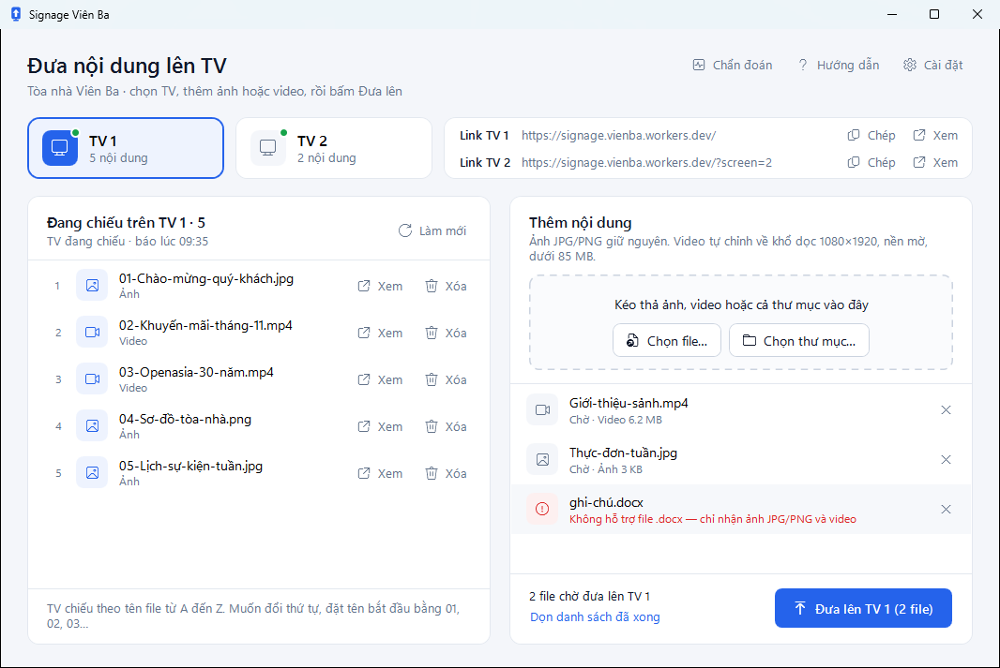

# Giới thiệu

**Signage Viên Ba** là phần mềm Windows để đưa ảnh và video lên 2 TV dọc ở tòa nhà Viên Ba. Bạn chọn TV, kéo file vào cửa sổ rồi bấm một nút. Phần mềm tự chỉnh video cho vừa màn hình dọc rồi gửi lên máy chủ mà TV đang mở.

<a href="bat-dau/cai-dat.md" class="button primary">Cài đặt</a> <a href="bat-dau/bat-dau-nhanh.md" class="button secondary">Bắt đầu nhanh</a> <a href="https://github.com/tdphuong97/digitalsignage/releases/latest" class="button secondary">Tải bản mới nhất</a>

<figure><figcaption>
Cửa sổ chính của Signage Viên Ba
</figcaption></figure>

## Tính năng chính

* **Kéo thả là xong**: kéo ảnh, video hoặc cả thư mục vào cửa sổ, rồi bấm **Đưa lên TV 1**.
* **Tự chỉnh video**: video ngang hay video quay bằng điện thoại đều được chỉnh về khổ dọc 1080×1920, nền mờ, dưới 85 MB.
* **Thấy ngay TV đang chiếu gì**: danh sách bên trái đúng theo thứ tự chiếu, có nút **Xem** và **Xóa** ở từng dòng. Ở đầu cửa sổ có link của TV 1, TV 2, bấm **Xem** để xem trang TV đang chiếu ngay trong phần mềm.
* **Tự chẩn đoán**: bấm **Chẩn đoán** để kiểm tra kết nối, mã API, nội dung trên 2 TV và máy đang dùng, kèm cách xử lý từng lỗi.
* **Tự cập nhật**: có bản mới thì phần mềm báo, bấm **Cập nhật ngay** là xong.
* **Hướng dẫn ngay trong phần mềm**: bấm **Hướng dẫn** ở góc trên cửa sổ hoặc nhấn `F1`, hướng dẫn mở trong một cửa sổ riêng, xem được cả khi không có mạng.

## Bạn cần đọc trang nào

<table data-view="cards">
  <thead>
    <tr>
      <th></th>
      <th></th>
      <th data-hidden data-card-target data-type="content-ref"></th>
    </tr>
  </thead>
  <tbody>
    <tr>
      <td><strong>Tôi đưa nội dung lên TV</strong></td>
      <td>Bắt đầu nhanh trong 5 bước, rồi xem cách thêm, xóa và đổi thứ tự nội dung.</td>
      <td><a href="bat-dau/bat-dau-nhanh.md">bat-dau-nhanh.md</a></td>
    </tr>
    <tr>
      <td><strong>Tôi cài phần mềm cho người khác</strong></td>
      <td>Tải bộ cài, nhập mã API lần đầu, gỡ phần mềm.</td>
      <td><a href="bat-dau/cai-dat.md">cai-dat.md</a></td>
    </tr>
    <tr>
      <td><strong>Tôi quản trị hệ thống</strong></td>
      <td>Chuyển từ script cũ sang phần mềm, mã API, cách các thành phần nối với nhau, phát hành bản mới.</td>
      <td><a href="quan-tri/chuyen-sang-phan-mem-moi.md">chuyen-sang-phan-mem-moi.md</a></td>
    </tr>
  </tbody>
</table>

## Yêu cầu hệ thống

| | Yêu cầu |
| --- | --- |
| Hệ điều hành | Windows 10 hoặc Windows 11, bản 64-bit |
| Ổ đĩa | Khoảng 330 MB, đã gồm bộ nén video |
| Mạng | Có Internet, để đưa file lên và kiểm tra bản mới |
| Quyền | Không cần quyền quản trị (admin) |
| Khác | **Mã API** do bộ phận IT cấp |
