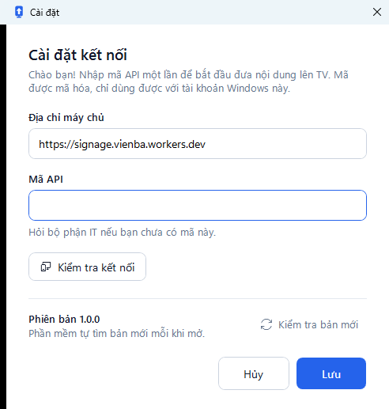
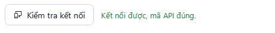

# Cài đặt

**Ai làm:** người sẽ dùng phần mềm, hoặc bộ phận IT · **Mất khoảng:** 5 phút


**Trước khi bắt đầu:** xin bộ phận IT **mã API**. Đây là mật khẩu để phần mềm được phép đưa file lên TV. Bạn không cần quyền quản trị Windows.




### Tải bộ cài

Mở trang [Releases của Signage Viên Ba](https://github.com/tdphuong97/digitalsignage/releases/latest). Ở mục **Assets**, bấm `SignageVienBa-Setup-<phiên bản>.exe` (khoảng 97 MB) để tải về.



### Chạy bộ cài

Mở file vừa tải. Nếu Windows hiện **Windows protected your PC**, bấm **More info** rồi **Run anyway** (Windows tiếng Việt: **Thông tin thêm** > **Vẫn chạy**). Windows hỏi lại vì bộ cài chưa có chữ ký số.



### Cài phần mềm

1. Ở màn hình **Chọn vị trí cài đặt**, giữ nguyên thư mục và bấm **Tiếp theo >**.
2. Ở **Các thiết lập bổ sung**, giữ ô **Tạo biểu tượng ngoài màn hình** rồi bấm **Tiếp theo >**.
3. Bấm **Cài đặt**. Cài xong, giữ ô **Mở Signage Viên Ba ngay** và bấm **Hoàn tất**.



### Nhập mã API

Lần đầu mở, cửa sổ **Cài đặt** tự hiện ra.

<figure><figcaption>
Cửa sổ Cài đặt khi mở phần mềm lần đầu
</figcaption></figure>

1. Giữ nguyên ô **Địa chỉ máy chủ** đã điền sẵn.
2. Nhập mã bộ phận IT đưa vào ô **Mã API**.
3. Bấm **Kiểm tra kết nối**. Dòng chữ xanh **Kết nối được, mã API đúng.** hiện ra.

   <figure><figcaption>
Kết nối thành công
</figcaption></figure>
4. Bấm **Lưu**.




**Kết quả:** cửa sổ chính hiện ra. Dưới **TV 1** và **TV 2** là số nội dung mỗi TV đang chiếu. Biểu tượng **Signage Viên Ba** có ngoài màn hình và trong menu **Start**. Mã API được mã hóa và chỉ dùng được với tài khoản Windows này, nên mỗi người dùng trên mỗi máy nhập một lần.


## Cập nhật

Bạn không cần tải lại bộ cài khi có bản mới. Phần mềm tự báo và tự cài, xem [Cập nhật phần mềm](../su-dung/cap-nhat-phan-mem.md).

## Gỡ cài đặt

Gỡ phần mềm và xóa mã API đã lưu

1. Mở **Settings** > **Apps** > **Installed apps** (Windows tiếng Việt: **Cài đặt** > **Ứng dụng** > **Ứng dụng đã cài đặt**).
2. Tìm **Signage Viên Ba**, bấm **⋯** > **Uninstall** (**Gỡ cài đặt**).
3. Muốn xóa cả mã API và cài đặt đã lưu, xóa thư mục `%APPDATA%\SignageVienBa`.

Gỡ phần mềm không xóa gì trên TV.

## Lỗi thường gặp

Mã API không đúng. Vào Cài đặt để nhập lại.

**Nguyên nhân:** mã nhập vào khác với mã đang dùng trên máy chủ, hoặc bộ phận IT vừa đổi mã.

**Cách khắc phục:** hỏi bộ phận IT mã mới nhất, nhập lại vào ô **Mã API**, bấm **Kiểm tra kết nối** rồi **Lưu**.

Không kết nối được tới máy chủ. Kiểm tra mạng Internet.

**Nguyên nhân:** máy không vào được Internet, hoặc mạng công ty chặn địa chỉ `signage.vienba.workers.dev`.

**Cách khắc phục:** mở một trang web bất kỳ để thử mạng. Nếu web vào được mà phần mềm vẫn báo lỗi, báo bộ phận IT kiểm tra tường lửa.

Địa chỉ máy chủ không hợp lệ. Vào Cài đặt để sửa.

**Nguyên nhân:** ô **Địa chỉ máy chủ** bị sửa nhầm.

**Cách khắc phục:** xóa nội dung ô đó, nhập lại `https://signage.vienba.workers.dev`, rồi bấm **Lưu**.

