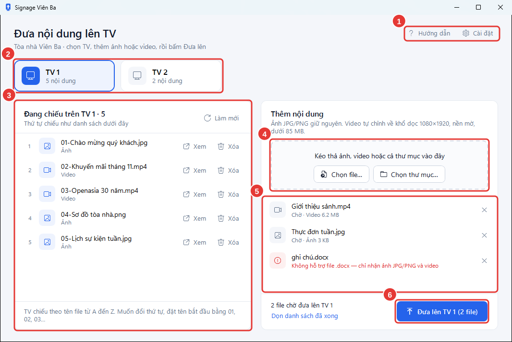

# Làm quen giao diện

Mọi việc làm trên cửa sổ chính. Phía trên là nơi chọn TV và link của từng TV, bên trái là những gì TV đang chiếu, bên phải là chỗ thêm nội dung mới. Hướng dẫn và nút **Xem** mở thêm cửa sổ riêng của phần mềm, không mở trình duyệt.

<figure><figcaption>
Các vùng trên cửa sổ chính
</figcaption></figure>

| Số | Vùng | Dùng để |
| --- | --- | --- |
| 1 | **Chẩn đoán**, **Hướng dẫn**, **Cài đặt** | **Chẩn đoán** tự kiểm tra kết nối, mã API, nội dung trên 2 TV và máy này, xem [Chạy chẩn đoán](../tham-khao/chan-doan.md). **Hướng dẫn** (hoặc nhấn `F1`) mở hướng dẫn này trong một cửa sổ riêng, không cần mạng. **Cài đặt** để nhập mã API, kiểm tra kết nối, xem phiên bản và kiểm tra bản mới. |
| 2 | **TV 1**, **TV 2** | Chọn TV cần làm việc. Dòng nhỏ bên dưới cho biết TV đó đang chiếu bao nhiêu nội dung. Chấm màu ở góc biểu tượng cho biết TV có đang chiếu không, xem bảng bên dưới. |
| 3 | **Link TV 1**, **Link TV 2** | Link mà mỗi TV mở để chiếu. **Chép** chép link, ví dụ để gửi cho người cài TV. **Xem** mở cửa sổ xem đúng trang TV đó đang chiếu, chạy lần lượt như trên TV. |
| 4 | **Đang chiếu trên TV 1** | Nội dung TV đang chiếu, theo đúng thứ tự chiếu. Dòng nhỏ dưới tiêu đề cho biết TV này có đang chiếu không, ví dụ **TV đang chiếu · báo lúc 09:35**. Mỗi dòng có **Xem** (mở ảnh, video trong cửa sổ xem) và **Xóa**. Bấm **Làm mới** để tải lại danh sách. |
| 5 | Khung kéo thả | Thả ảnh, video hoặc thư mục vào đây, hoặc bấm **Chọn file…**, **Chọn thư mục…**. |
| 6 | Danh sách chờ | Các file vừa thêm và trạng thái của từng file. Tên hiện ở đây là tên sẽ có trên TV. |
| 7 | **Đưa lên TV 1** | Bắt đầu gửi các file đang chờ lên TV đã chọn. Khi đang gửi, nút này đổi thành **Dừng**. |

## Chấm trạng thái của TV

Mỗi phút trang chiếu trên TV báo về máy chủ. Phần mềm đọc lại mỗi phút và tô chấm ở góc biểu tượng **TV 1**, **TV 2**:

| Chấm | Nghĩa là | Bạn cần làm gì |
| --- | --- | --- |
| Xanh lá | TV đang chiếu bình thường. | Không cần làm gì. |
| Cam | Trong giờ TV bật (8:00–18:00, thứ 2–thứ 6) mà hơn 3 phút không nhận tín hiệu: TV tắt, mất Wi-Fi hoặc trang chiếu bị đóng. | Ra xem TV. Nếu thấy trang trình duyệt trống, tắt rồi bật lại TV bằng remote. |
| Xám | Ngoài giờ TV bật, TV đang tắt theo lịch. | Không cần làm gì. |
| Không có chấm | Chưa nhận tín hiệu nào: máy chủ chưa được cập nhật, hoặc máy này không vào được mạng. | Bấm **Chẩn đoán** để xem lý do. |

## Trạng thái file trong danh sách chờ

| Trạng thái | Ý nghĩa | Bạn cần làm gì |
| --- | --- | --- |
| **Chờ · Video 22.3 MB** | File đã vào danh sách, chưa gửi. | Bấm **Đưa lên TV …**. |
| **… · sẽ thay bản cùng tên trên TV** | TV đang có file cùng tên; file mới sẽ thay file cũ. | Không cần làm gì nếu bạn muốn thay. Nếu không, bỏ file khỏi danh sách và đổi tên. |
| **Đang kiểm tra video…** | Phần mềm đang đọc thông tin video. | Chờ. |
| **Đang nén video · 42%** | Video đang được chỉnh về khổ dọc. | Chờ. Video dài có thể mất vài phút. |
| **Đang tải lên · 63%** | File đang được gửi lên máy chủ. | Chờ, giữ kết nối mạng. |
| **Đã đưa lên TV 1** (chữ xanh lá) | Xong. | Không cần làm gì. |
| Dòng chữ đỏ | File không được gửi; dòng chữ là lý do. | Xem [Xử lý sự cố](../tham-khao/xu-ly-su-co.md). |

Dòng chữ cuối khung bên phải tóm tắt tình hình, ví dụ **2 file chờ đưa lên TV 1** hoặc **Xong: 2 file đã lên TV 1. TV sẽ chiếu từ vòng sau.**
