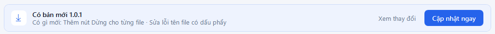
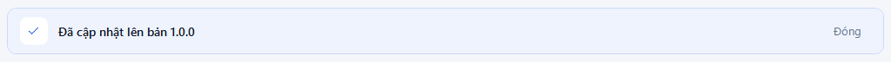
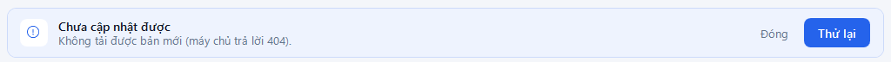

# Cập nhật phần mềm

**Ai làm:** người dùng phần mềm · **Khi nào:** khi thanh **Có bản mới …** hiện ở đầu cửa sổ

Mỗi lần mở, và cứ 6 tiếng một lần nếu để mở cả ngày, phần mềm tự kiểm tra bản mới. Có bản mới thì thanh này hiện ra:

<figure><figcaption>
Thông báo có bản mới
</figcaption></figure>

1. (Không bắt buộc) Bấm **Xem thay đổi** để đọc bản mới có gì. Trang phát hành mở trong trình duyệt.
2. Bấm **Cập nhật ngay**. Thanh đổi thành **Đang tải bản mới … · 45%**.
3. Chờ khoảng 1 phút. Tải xong, phần mềm tự đóng, cài bản mới rồi tự mở lại. Bạn không cần bấm gì trong lúc này.


**Kết quả:** phần mềm mở lại với thanh **Đã cập nhật lên bản …**. Bấm **Đóng** để ẩn thanh này. Cài đặt và mã API được giữ nguyên.


<figure><figcaption>
Sau khi cập nhật xong
</figcaption></figure>

Nếu bạn đang đưa file lên TV, phần mềm nhắc **Đang đưa file lên TV. Đợi xong rồi bấm Cập nhật ngay.** Đợi các file gửi xong rồi bấm lại.

Muốn tự kiểm tra ngay mà không chờ, bấm **Cài đặt** > **Kiểm tra bản mới**. Có bản mới thì nút **Cập nhật ngay** hiện ngay trong cửa sổ **Cài đặt**; bấm nút đó, cửa sổ **Cài đặt** tự đóng và việc tải bản mới hiện ở thanh đầu cửa sổ chính như bước 2.

## Lỗi thường gặp

Chưa cập nhật được

<figure><figcaption>
Cập nhật bị lỗi
</figcaption></figure>

Dòng dưới cho biết lý do, thường là mạng bị ngắt khi đang tải. Kiểm tra mạng rồi bấm **Thử lại**. Nếu thấy **Bản mới tải về bị hỏng hoặc không đúng, phần mềm đã bỏ nó đi.**, phần mềm đã chặn một file không khớp với bản phát hành; bấm **Thử lại** sau ít phút. Lỗi lặp lại thì báo bộ phận IT.

Không kiểm tra được bản mới. Hãy thử lại khi có mạng.

Dòng này chỉ hiện khi bạn bấm **Kiểm tra bản mới** trong **Cài đặt** lúc mất mạng. Phần mềm vẫn dùng bình thường; lần mở sau nó sẽ tự kiểm tra lại.

