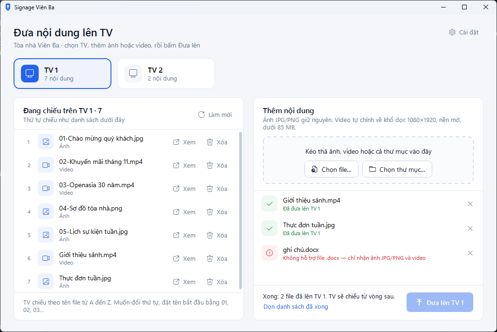

# Đưa ảnh, video lên TV

**Ai làm:** người phụ trách nội dung trên TV · **Mất khoảng:** dưới 1 phút với ảnh, vài phút với video dài


**Trước khi bắt đầu:** chuẩn bị ảnh JPG, PNG hoặc video (MP4, MOV và các định dạng phổ biến khác, xem [Cách phần mềm xử lý video](../tinh-nang/xu-ly-video.md)). TV chiếu theo tên file từ A đến Z, nên đặt tên theo thứ tự muốn chiếu trước khi đưa lên, xem [Đổi thứ tự chiếu](doi-thu-tu-chieu.md).




### Chọn TV

Bấm **TV 1** hoặc **TV 2** ở đầu cửa sổ. Danh sách bên trái đổi thành **Đang chiếu trên TV 1** (hoặc **TV 2**).



### Thêm file vào danh sách chờ

Chọn một trong các cách sau:



Kéo file hoặc thư mục từ File Explorer vào bất kỳ chỗ nào trong cửa sổ. Khung nét đứt đổi màu và hiện **Thả vào để thêm vào danh sách**. Thả chuột.



1. Bấm **Chọn file…**.
2. Chọn một hoặc nhiều file (giữ `Ctrl` để chọn nhiều), rồi bấm **Open** (**Mở**).



1. Bấm **Chọn thư mục…**.
2. Chọn thư mục rồi bấm **Select Folder** (**Chọn thư mục**).

Phần mềm lấy mọi ảnh và video trong thư mục, kể cả thư mục con. File ẩn và file không phải ảnh, video được bỏ qua.



Khi phần mềm chưa mở, kéo file thả lên biểu tượng **Signage Viên Ba** ngoài màn hình. Phần mềm mở ra với các file đó trong danh sách chờ.



File hiện ở khung bên phải với trạng thái **Chờ**. File không hỗ trợ hiện dòng chữ đỏ, ví dụ **Không hỗ trợ file .docx — chỉ nhận ảnh JPG/PNG và video**, và sẽ được bỏ qua.



### Xem lại danh sách chờ

* Muốn bỏ một file, bấm nút **×** ở cuối dòng.
* Nếu dòng có thêm **sẽ thay bản cùng tên trên TV**, file này sẽ thay file cùng tên đang chiếu.



### Bấm Đưa lên

Bấm **Đưa lên TV 1** (số file đang chờ ghi trong ngoặc). Phần mềm xử lý lần lượt từng file: video qua **Đang nén video**, rồi mọi file qua **Đang tải lên**.

<figure><figcaption>
Đã đưa xong lên TV 1
</figcaption></figure>

Muốn dừng giữa chừng, bấm **Dừng**. File đang làm dở quay về **Chờ** kèm chữ **đã dừng**. Bấm lại **Đưa lên TV 1** để làm tiếp.




**Kết quả:** cuối khung bên phải hiện **Xong: 2 file đã lên TV 1. TV sẽ chiếu từ vòng sau.** Danh sách bên trái có thêm các file mới. TV chiếu nội dung mới khi hết vòng chiếu hiện tại. Bấm **Dọn danh sách đã xong** để xóa các dòng đã xong khỏi khung bên phải.


Trong lúc phần mềm đang gửi, bạn không đổi TV được. Bạn vẫn thêm file được; file mới thêm sẽ được gửi tiếp lên cùng TV đó.

## Lỗi thường gặp

Mã API không đúng. Vào Cài đặt để nhập lại.

Bộ phận IT có thể vừa đổi mã. Hỏi mã mới, bấm **Cài đặt**, nhập lại vào ô **Mã API**, bấm **Lưu**, rồi bấm **Đưa lên TV …** lần nữa.

Video dài … phút, quá dài để nén dưới 85 MB. Hãy cắt ngắn còn khoảng 35 phút trở xuống.

Mỗi file gửi lên tối đa khoảng 100 MB, nên video dài hơn khoảng 35 phút không nén vừa mà vẫn xem rõ được. Cắt video thành các đoạn ngắn hơn (ví dụ bằng ứng dụng **Clipchamp** có sẵn trên Windows 11) rồi đưa từng đoạn lên.

Không hỗ trợ file .heic — chỉ nhận ảnh JPG/PNG và video

Ảnh chụp bằng iPhone thường là HEIC. Đổi ảnh sang JPG rồi thêm lại. Để ảnh chụp sau này là JPG, trên iPhone chọn **Cài đặt** > **Camera** > **Định dạng** > **Tương thích nhất**.

Đang đưa file lên TV. Thoát bây giờ sẽ dừng giữa chừng.

Bạn vừa đóng cửa sổ khi phần mềm đang gửi. Bấm **No** (**Không**) để phần mềm làm tiếp. Nếu bấm **Yes** (**Có**), file đang gửi dở sẽ không lên TV; mở lại phần mềm và đưa lại file đó.

Các lỗi khác xem [Xử lý sự cố](../tham-khao/xu-ly-su-co.md).
