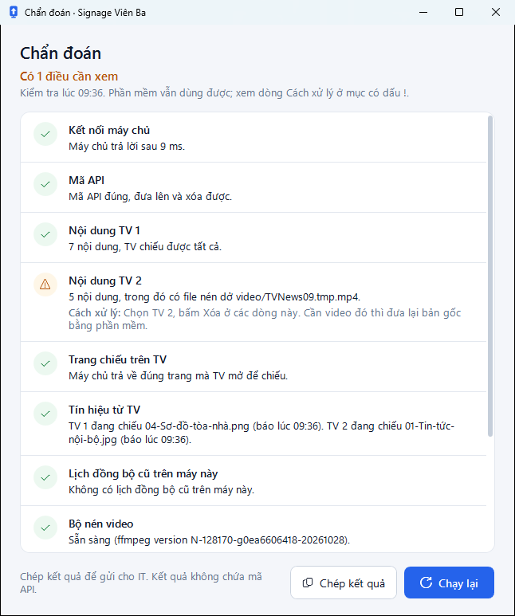

# Chạy chẩn đoán

**Ai làm:** người dùng phần mềm · **Khi nào:** đưa lên không được, TV chiếu sai hoặc không chiếu · **Mất khoảng:** vài giây

1. Bấm **Chẩn đoán** ở góc trên cửa sổ chính. Nếu danh sách TV đang báo không kết nối được, bấm **Chạy chẩn đoán** ngay dưới thông báo đó.
2. Chờ vài giây. Dòng trên cùng của cửa sổ **Chẩn đoán** cho biết kết quả chung: **Mọi thứ đều ổn**, **Có … điều cần xem** hoặc **Có … lỗi cần xử lý**.
3. Ở mỗi mục có dấu **!** hoặc **✕**, làm theo dòng **Cách xử lý**, rồi bấm **Chạy lại** để kiểm tra lại.

<figure><figcaption>
Kết quả chẩn đoán
</figcaption></figure>


Cần IT giúp thì bấm **Chép kết quả**, rồi dán vào tin nhắn hoặc email gửi IT. Kết quả kèm nhật ký gần đây của từng TV (mở trang lúc nào, có mạng không, file nào bị bỏ qua) và không chứa mã API.


## Các mục được kiểm tra

| Mục | Kiểm tra gì | Khi có dấu ! hoặc ✕ |
| --- | --- | --- |
| **Kết nối máy chủ** | Máy này có tới được máy chủ mà TV đang mở không. | Kiểm tra mạng, Wi-Fi. Các mục **Mã API**, **Nội dung TV**, **Trang chiếu trên TV**, **Tín hiệu từ TV** được bỏ qua cho tới khi kết nối được. |
| **Mã API** | Mã API trong **Cài đặt** có đúng không, tức là có đưa lên và xóa được không. | Vào **Cài đặt**, nhập lại mã API. Không có mã thì hỏi IT. |
| **Nội dung TV 1**, **Nội dung TV 2** | TV có đang trống không, còn file nén dở (tên có `.tmp`) hay file TV không chiếu được (không phải ảnh JPG, PNG hoặc video MP4) không. | Chọn TV đó, bấm **Xóa** ở các dòng được nêu tên. Cần video đó thì đưa lại bản gốc bằng phần mềm. |
| **Trang chiếu trên TV** | Máy chủ có trả về đúng trang mà TV mở để chiếu không. | Báo IT. Trang này lỗi thì cả 2 TV không hiện gì. |
| **Tín hiệu từ TV** | Mỗi TV có đang mở trang chiếu và báo về máy chủ không, đang chiếu file nào. | TV bật theo lịch 8:00–18:00, thứ 2–thứ 6. Trong giờ đó mà mất tín hiệu: ra xem TV, nếu thấy trang trình duyệt trống thì tắt rồi bật lại bằng remote. |
| **Lịch đồng bộ cũ trên máy này** | Máy này còn lịch đồng bộ từ thư mục OneDrive cũ đang bật không. Lịch này xóa trên TV những gì bạn đưa lên bằng phần mềm. | Nhờ IT tắt lịch này. Mục này chỉ xem được máy đang dùng, không xem được máy khác. |
| **Bộ nén video** | Bộ nén video đi kèm phần mềm còn chạy được không. | Cài lại phần mềm bằng bộ cài mới nhất, xem [Cài đặt](../bat-dau/cai-dat.md). |
| **Ổ đĩa** | Ổ đĩa nơi phần mềm nén video còn trống bao nhiêu. Dưới 3 GB là cảnh báo, dưới 1 GB là lỗi. | Dọn thùng rác và thư mục Downloads. |
| **Phiên bản phần mềm** | Có bản mới hơn không. | Bấm **Cập nhật ngay**, xem [Cập nhật phần mềm](../su-dung/cap-nhat-phan-mem.md). |
| **Cửa sổ xem và hướng dẫn** | File hướng dẫn và WebView2 (phần Windows mà cửa sổ xem và cửa sổ hướng dẫn dùng) có sẵn không. | Thiếu file hướng dẫn thì cài lại phần mềm. Thiếu WebView2 thì hướng dẫn và nút **Xem** mở bằng trình duyệt; nhờ IT cài nếu muốn. |

Chẩn đoán chỉ đọc thông tin, không thay đổi nội dung trên TV.
