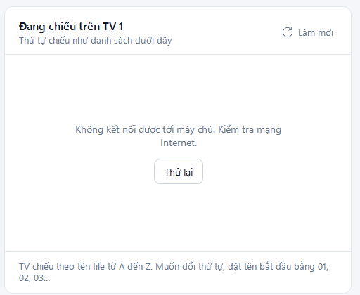

# Xử lý sự cố

Mỗi mục dưới đây là đúng câu phần mềm hiện ra. Tìm câu bạn thấy (nhấn `Ctrl` + `F`), đọc nguyên nhân và làm theo cách khắc phục.

## Kết nối

Không kết nối được tới máy chủ. Kiểm tra mạng Internet.

**Nguyên nhân:** máy không vào được Internet, hoặc mạng chặn địa chỉ `signage.vienba.workers.dev`.

**Cách khắc phục:** mở một trang web bất kỳ để thử mạng, rồi bấm **Thử lại** hoặc **Làm mới**. Web vào được mà phần mềm vẫn lỗi thì báo bộ phận IT kiểm tra tường lửa.

<figure><figcaption>
Danh sách không tải được khi mất mạng
</figcaption></figure>

Máy chủ không phản hồi. Kiểm tra mạng rồi thử lại.

**Nguyên nhân:** mạng quá chậm hoặc chập chờn, máy chủ không trả lời trong 30 giây.

**Cách khắc phục:** chờ một lúc rồi thử lại. Nếu lặp lại nhiều lần, báo bộ phận IT.

Mã API không đúng. Vào Cài đặt để nhập lại.

**Nguyên nhân:** mã trong **Cài đặt** khác mã trên máy chủ, thường do bộ phận IT vừa đổi mã.

**Cách khắc phục:** hỏi bộ phận IT mã mới, bấm **Cài đặt**, nhập vào ô **Mã API**, bấm **Kiểm tra kết nối** rồi **Lưu**.

Địa chỉ máy chủ không hợp lệ. Vào Cài đặt để sửa.

**Nguyên nhân:** ô **Địa chỉ máy chủ** bị sửa nhầm.

**Cách khắc phục:** trong **Cài đặt**, nhập lại `https://signage.vienba.workers.dev` rồi bấm **Lưu**.

Không tìm thấy máy chủ. Kiểm tra địa chỉ trong Cài đặt. / Máy chủ trả về danh sách không đọc được.

**Nguyên nhân:** địa chỉ máy chủ sai, trỏ tới một trang khác.

**Cách khắc phục:** như mục trên, nhập lại đúng địa chỉ.

Máy chủ đang lỗi (5xx). Thử lại sau ít phút.

**Nguyên nhân:** máy chủ Cloudflare đang trục trặc.

**Cách khắc phục:** thử lại sau vài phút. Kéo dài quá 30 phút thì báo bộ phận IT.

## Đưa file lên

Mạng bị ngắt giữa chừng (không gửi được dữ liệu trong 60 giây). Thử lại.

**Nguyên nhân:** mạng mất khi đang gửi file.

**Cách khắc phục:** chờ có mạng lại. Bấm nút **×** để bỏ dòng lỗi, thêm lại file đó rồi bấm **Đưa lên TV …**.

Không hỗ trợ file .… — chỉ nhận ảnh JPG/PNG và video

**Nguyên nhân:** file không phải ảnh JPG, PNG hay video, ví dụ ảnh iPhone `.heic`, file `.gif`, `.pdf`, `.docx`.

**Cách khắc phục:** xuất file sang JPG, PNG hoặc MP4 rồi thêm lại. Xem [Cách phần mềm xử lý video](../tinh-nang/xu-ly-video.md) để biết các định dạng được nhận.

Ảnh lớn hơn 95 MB, không tải lên được. Hãy xuất lại ảnh nhỏ hơn.

**Nguyên nhân:** máy chủ nhận tối đa khoảng 100 MB mỗi file.

**Cách khắc phục:** xuất lại ảnh ở kích thước 1080×1920, dạng JPG. Ảnh như vậy thường chỉ vài MB.

Không tìm thấy file (đã bị xóa hoặc đổi tên?).

**Nguyên nhân:** file bị xóa, đổi tên hoặc chuyển chỗ sau khi đã thêm vào danh sách chờ, hoặc ổ USB chứa file đã bị rút ra.

**Cách khắc phục:** bỏ dòng đó và thêm lại file từ chỗ mới.

Không tìm thấy ảnh hoặc video nào trong những gì bạn chọn.

**Nguyên nhân:** thư mục bạn chọn không có ảnh JPG, PNG hay video nào.

**Cách khắc phục:** chọn đúng thư mục chứa nội dung.

## Video

Video dài … phút, quá dài để nén dưới 85 MB. Hãy cắt ngắn còn khoảng 35 phút trở xuống.

**Nguyên nhân:** video quá dài để nén xuống dưới 85 MB mà vẫn xem rõ được.

**Cách khắc phục:** cắt video thành các đoạn ngắn hơn (ví dụ bằng ứng dụng **Clipchamp** trên Windows 11), rồi đưa từng đoạn lên.

Video sau khi nén vẫn lớn hơn 95 MB. Hãy cắt ngắn video.

**Nguyên nhân:** hiếm gặp; video có nội dung quá phức tạp nên file sau khi nén vẫn lớn.

**Cách khắc phục:** cắt video ngắn hơn rồi thử lại.

Không đọc được video này (file hỏng hoặc định dạng lạ). / File này không có hình (không phải video). / Nén video thất bại.

**Nguyên nhân:** file video bị hỏng, chép chưa xong, hoặc thật ra là file âm thanh.

**Cách khắc phục:** mở thử file bằng ứng dụng xem video trên máy. Xem được thì xuất lại sang MP4 rồi thêm lại; không xem được thì xin lại file gốc.

Không tìm thấy bộ nén video (thư mục ffmpeg cạnh phần mềm). / Thiếu bộ nén video (ffmpeg). Hãy cài lại phần mềm.

**Nguyên nhân:** thư mục `ffmpeg` trong thư mục cài đặt bị xóa, thường do phần mềm diệt virus. Ảnh vẫn đưa lên được, video thì không.

**Cách khắc phục:** chạy lại bộ cài mới nhất, xem [Cài đặt](../bat-dau/cai-dat.md). Mã API đã lưu được giữ nguyên.

## Cập nhật

Chưa cập nhật được

Xem phần lỗi trong [Cập nhật phần mềm](../su-dung/cap-nhat-phan-mem.md).

## Hướng dẫn

Không tìm thấy file hướng dẫn. Hãy cài lại phần mềm bằng bộ cài mới nhất.

**Nguyên nhân:** file `HuongDan.html` trong thư mục cài đặt bị xóa, thường do phần mềm diệt virus hoặc xóa nhầm.

**Cách khắc phục:** chạy bộ cài mới nhất, xem [Cài đặt](../bat-dau/cai-dat.md). Mã API đã lưu được giữ nguyên.

## Gửi báo lỗi

Nếu các cách trên không được, hoặc gặp hộp **Có lỗi không mong muốn**, gửi cho bộ phận IT:

* số phiên bản (trong **Cài đặt**, dòng **Phiên bản …**);
* ảnh chụp màn hình lúc lỗi (`Win` + `Shift` + `S`);
* file `log.txt` trong thư mục `%APPDATA%\SignageVienBa` (dán đường dẫn này vào thanh địa chỉ của File Explorer).
