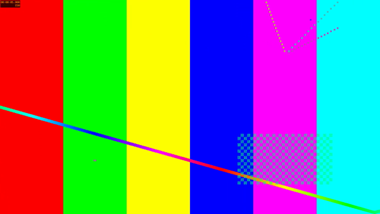
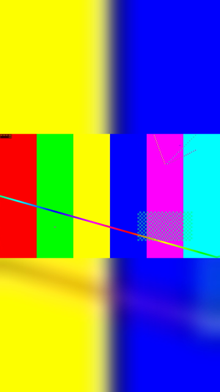

# Cách phần mềm xử lý video

Hai TV đặt dọc, màn hình 1080×1920. Trước khi gửi, phần mềm chỉnh mọi video về đúng khổ này ngay trên máy tính của bạn. Video gốc trên máy không bị sửa.



<figure><figcaption>
Trước: video khổ ngang
</figcaption></figure>



<figure><figcaption>
Sau: khổ dọc, nền mờ
</figcaption></figure>



## Phần mềm làm gì với video

* **Khổ dọc 1080×1920.** Hình được thu nhỏ cho vừa khung, không bị cắt mất phần nào. Phần trống phía trên, dưới (hoặc hai bên) được lấp bằng chính video đó phóng to và làm mờ.
* **30 hình/giây.** Video 60 hình/giây được giảm xuống 30 để TV phát mượt.
* **Dưới 85 MB.** Máy chủ nhận tối đa khoảng 100 MB mỗi file, nên phần mềm chọn chất lượng vừa đủ để file dưới 85 MB.
* **Giữ âm thanh.** Tiếng được giữ lại.
* **Bỏ qua khi đã đúng chuẩn.** Video đã là MP4 (H.264) khổ 1080×1920, tối đa 30 hình/giây và dưới 90 MB được gửi nguyên, không nén lại.

Nén chạy với mức ưu tiên thấp nên bạn vẫn dùng máy được trong lúc chờ. Thời gian nén tùy độ dài video và tốc độ máy.

## Số đo thật từ một video thử

| | Trước | Sau |
| --- | --- | --- |
| Khổ hình | 1920×1080 (ngang) | 1080×1920 (dọc) |
| Thời lượng | 90 giây | 90 giây |
| Tốc độ | 60 hình/giây | 30 hình/giây |
| Dung lượng | 315 MB | 22,5 MB |

## Định dạng được nhận

| Loại | Đuôi file | Ghi chú |
| --- | --- | --- |
| Ảnh | `.jpg`, `.jpeg`, `.png` | Gửi nguyên, không chỉnh. Tối đa 95 MB. |
| Video | `.mp4`, `.mov`, `.m4v`, `.avi`, `.mkv`, `.wmv`, `.webm`, `.mpg`, `.mpeg`, `.3gp`, `.flv`, `.ts`, `.mts`, `.m2ts` | Luôn thành `.mp4` khi lên TV. |

Các loại khác (ví dụ `.heic`, `.gif`, `.pdf`, `.docx`) không được nhận.

## Giới hạn

* **Video dài tối đa khoảng 35 phút.** Dài hơn thì không nén xuống dưới 85 MB mà vẫn xem rõ được; phần mềm báo **Video dài … phút, quá dài để nén dưới 85 MB.** và bỏ qua file đó.
* **Ảnh ngang có viền đen.** Ảnh không được chỉnh như video: ảnh ngang hiện ở giữa màn hình dọc, trên và dưới để đen. Muốn ảnh kín màn hình, thiết kế ảnh khổ dọc 1080×1920.
